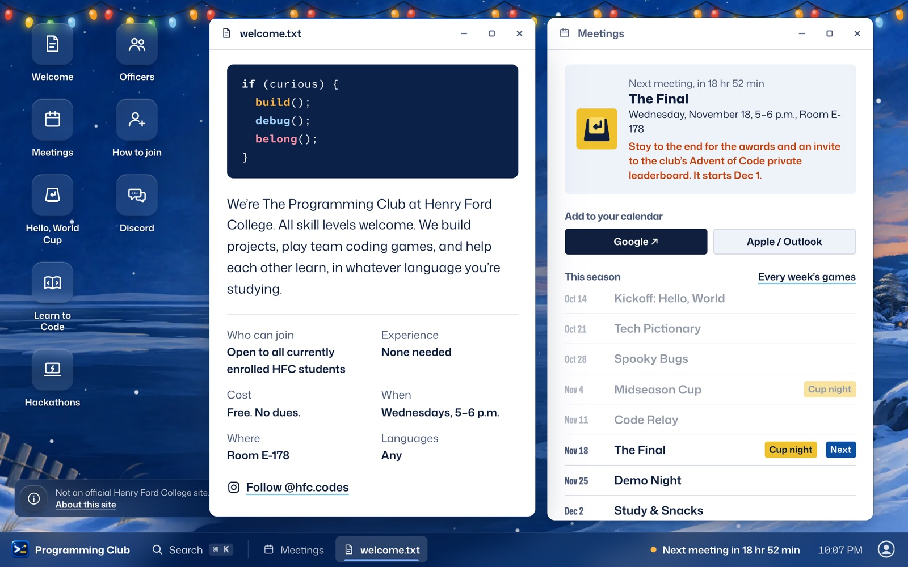
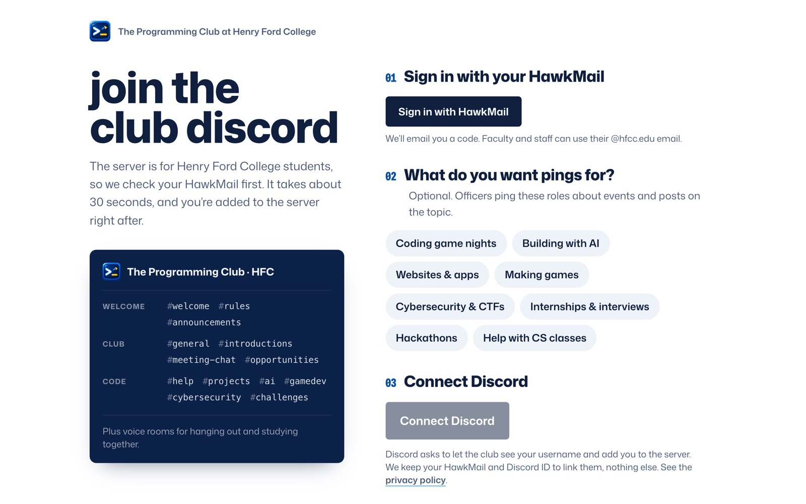
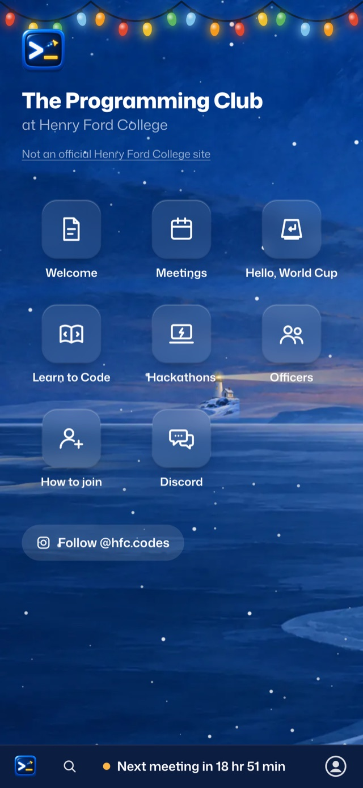
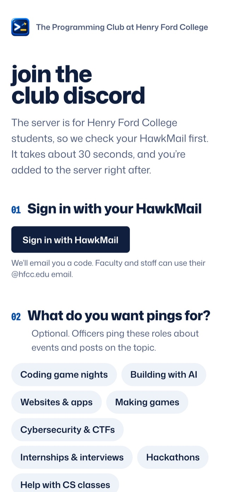

<div align="center">


# The Programming Club

**The website and club tools for The Programming Club at Henry Ford College.**

[](https://programmingclub.dev) [](LICENSE) [](CONTRIBUTING.md)

[Website](https://programmingclub.dev) · [Contributing](CONTRIBUTING.md) · [Code of Conduct](CODE_OF_CONDUCT.md)

<br />



</div>

## What's inside

- **A desktop for a home page.** [programmingclub.dev](https://programmingclub.dev) is a little operating system: open windows for meetings, officers, hackathons nearby, learning to code, and how to join. The wallpaper changes with the season.
- **A members-only Discord.** The club's server is for club members. They sign in with their HawkMail and connect Discord at `/discord`, and the club's bot adds them to the server with the roles they picked.
- **A member survey.** What members want, how they code, and when they're free, with cross-filtering charts so officers can plan around it.

## Screenshots


<p align="center"><sub><b>Joining the club Discord</b>: HawkMail-verified, roles by interest</sub></p>

<p align="center">
  
  &nbsp;&nbsp;&nbsp;
  
</p>

## Built with

| Layer | What we use |
| --- | --- |
| **App** | [TanStack Start](https://tanstack.com/start) and React, styled with [Tailwind CSS](https://tailwindcss.com) |
| **Backend** | [Convex](https://convex.dev): the database, live data, and the Discord bot's OAuth callback |
| **Sign-in** | [Clerk](https://clerk.com), with HawkMail for members |
| **Tooling** | [Bun](https://bun.sh) workspaces, TypeScript, ESLint, Prettier, Playwright |
| **Hosting** | [Vercel](https://vercel.com), which deploys Convex on every push to `main` |

## Repo layout

A Bun workspace with one app today, room for more.

| Path | What it is |
| --- | --- |
| [`apps/web`](apps/web) | **programmingclub.dev**: the club's home page, the Discord join page, and the member survey |

New projects (another event, a club tool) go in `apps/<name>` with their own `package.json`. Shared code can move into `packages/<name>` later and be added to `workspaces` in the root `package.json`.

## Running it locally

```bash
bun install          # once, from the repo root
bun run dev          # runs apps/web
bun run typecheck    # every workspace
bun run lint
```

You'll need your own free Convex and Clerk dev setups. [CONTRIBUTING.md](CONTRIBUTING.md) walks through it, and no access to the club's accounts is needed.

## Contributing

Contributions are welcome from club members and anyone else. Start with [CONTRIBUTING.md](CONTRIBUTING.md). Everyone follows the [Code of Conduct](CODE_OF_CONDUCT.md), and security problems go through [SECURITY.md](SECURITY.md).

## License

[MIT](LICENSE). The license covers the code, not Henry Ford College's name or logos.

<br />

<p align="center"><sub>Made by students at Henry Ford College. Not an official Henry Ford College site.</sub></p>
